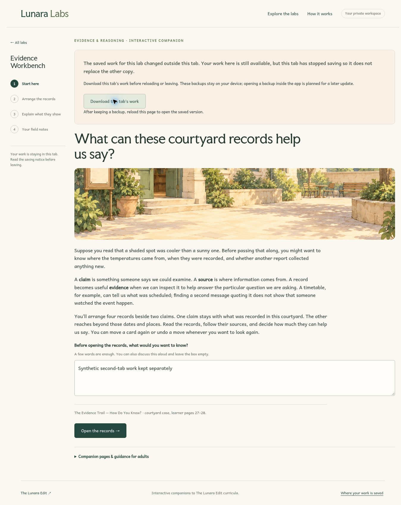

# Saved-progress protection

## Trigger and behavior

Previously, restoration returned a fresh attempt for an unsupported envelope. The next interaction could write that fresh state over the original saved work. Independent tabs also wrote without checking whether their initial copy was stale.

All three labs now use one storage boundary. A supported envelope still passes through its existing field validation and migration. An unsupported version, invalid JSON or unrecognized envelope opens a session-only activity and preserves the original stored bytes. The catalog labels these records as protected rather than treating them as saved field notes.

A write compares the current stored bytes with the last value this session read or successfully wrote. A mismatch stops further writes for that mounted lab. Storage events, window focus and page restoration also check for changes. Another lab’s changes and session-storage events do not stop this attempt. Detected conflicts remain blocked until reload; a later matching value does not silently re-enable saving.

The controls keep working in memory. The notice offers a local JSON backup of this tab’s current attempt, including partial notes and board/round state. Unsupported or unreadable records also have an exact original-copy download. Existing field-note exports remain available. Reloading opens the currently saved version and discards unexported session-only changes; opening backup files inside the app is not implemented yet.

## Responsibility and compatibility

- `attemptStorage.ts`: read classification, original backup, write comparison and sticky failure status. Injected storage makes failures and competing sessions directly testable.
- `useAttemptStorage.ts`: React status and storage/focus/pageshow listeners, with cleanup. It writes nothing on mount.
- Each lab definition: key, supported envelope versions, write version and its own restoration function. Rumor/Attention support 0.1.0, 0.2.0 and the current 0.3.0; Evidence retains its distinct 1.0.0 contract.
- Each lab controller: transitions, current in-memory work and when to save. Attention retains its monotonic clock, once-per-second tick snapshots and precise pause flush. No new timer is introduced by storage status updates.
- `SavingNotice`: explains why saving stopped and provides local copies without claiming they are server records or importable results.

No keys or result schemas are changed. Legacy activity versions, field notes, scoring, narration and educational content are preserved. A quota/read failure stops saving without resetting the current state or retrying destructively.

## Concurrency limit

This is optimistic conflict detection, not a transaction or a cross-tab lock. A read followed by a write can still race a simultaneous write in another process. The [HTML storage specification](https://html.spec.whatwg.org/multipage/webstorage.html#introduction) explicitly advises assuming no locking mechanism. The tests establish protection for observed changes and for a change present before the write check; they do not prove atomic simultaneous-write safety. The attempt-library milestone must select transactional storage or explicit serialization before making that guarantee.

## Verification

Ten new core tests cover the three version contracts, legacy identity, unreadable envelopes, pre-event conflicts, removed keys, sticky conflicts, unrelated keys and storage failures. Eight new browser scenarios run at desktop and narrow widths: future saves and exact backups in all three labs; real two-tab edits in Rumor/Evidence; Attention timer/route cleanup after another tab writes; same-tab pre-write detection with unrelated changes ignored; and malformed-record recovery. Existing flows remain part of the full suite.

The manual desktop walkthrough used two Evidence tabs and synthetic notes: the second tab received a warning, retained its own edits and downloaded a backup; reloading the first tab still showed its saved revision. The repository screenshot records that notice with authored sample work. Real-device and assistive-technology reviews remain pending.

